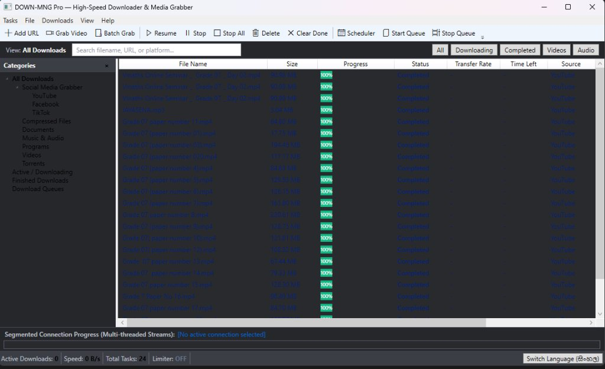
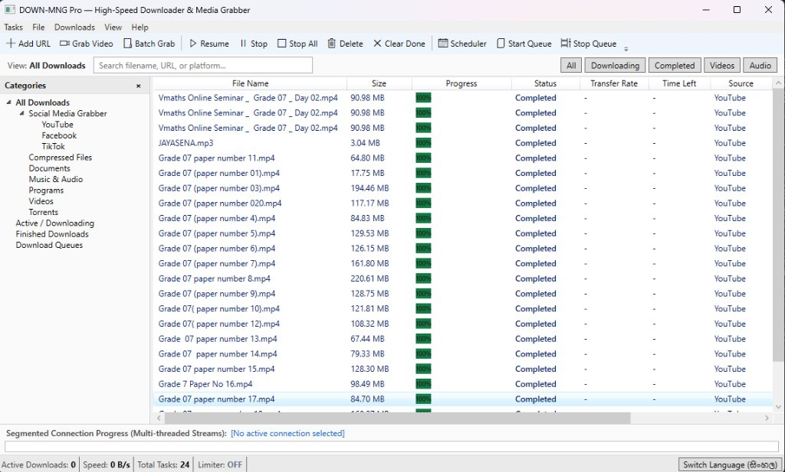
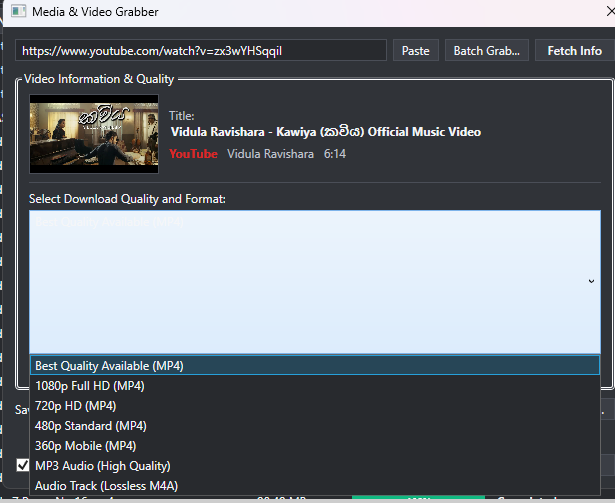
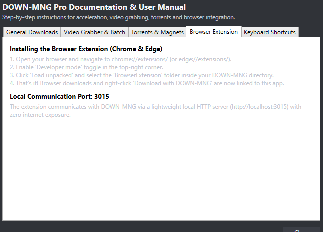

# ⚡ NexLoad Pro

<div align="center">


**Next-Generation High-Speed Download Accelerator, BitTorrent Client, Cloud Storage Resolver & Universal Media Grabber for Windows.**

[Features](#-key-features) • [Screenshots](#-screenshots) • [Cloud Hosters](#-cloud-hosters-support) • [Installation](#-installation--quick-start) • [Browser Extension](#-1-click-browser-extension) • [Shortcuts](#-keyboard-shortcuts)

</div>

---

## 📖 Overview

**NexLoad Pro** is a modern, ultra-fast Windows desktop download manager engineered in C# and WPF on **.NET 10.0**. It combines the best acceleration traits of **Internet Download Manager (IDM)** and the link-grabbing/cloud-resolving superpowers of **JDownloader**, delivered through a clean, native Windows desktop user interface.

Whether downloading massive files with multi-threaded chunking, streaming media from YouTube and TikTok in 4K or MP3, downloading BitTorrent magnet links, or grabbing direct links from **Pixeldrain, MEGA, and MediaFire**, NexLoad Pro handles everything seamlessly in the background.

---

## ✨ Key Features

- **🚀 Multi-Threaded Stream Acceleration:**
  - Segments files into up to **32 parallel connections**, dynamically merging chunks on-the-fly and completely eliminating ISP server speed throttling.
- **☁️ Cloud & File Hosters Direct Downloader (JDownloader Style):**
  - **Pixeldrain:** Auto-resolves `pixeldrain.com/u/{id}` and album lists (`/l/{id}`) into high-speed chunked direct streams.
  - **MEGA (mega.nz):** Full end-to-end streaming decryption (`AES-128-CTR`) for public file and folder links (`/file/` & `/folder/`).
  - **MediaFire:** Landing page bypass with direct high-speed CDN extraction.
  - **Google Drive, Dropbox, & GoFile:** Direct file stream resolution with automatic Google virus scan warning bypass.
- **🎥 Universal Media & Video Grabber:**
  - Embedded **yt-dlp & FFmpeg** engine for **YouTube, Facebook, TikTok, Instagram, Twitter/X, Reddit, Vimeo**, and more.
  - Instant format selection: **4K Ultra HD (2160p), 1440p 2K, 1080p FHD, 720p HD**, or **Lossless MP3 Audio Extraction**.
- **🧲 Full BitTorrent & Magnet Integration:**
  - Powered by embedded **MonoTorrent 3.0.2** with DHT, peer exchange, and a selective file selection dialog for multi-file torrents.
- **📋 Batch Link Grabber (From Text):**
  - Paste any block of raw text, chat log, email, or HTML; NexLoad extracts, deduplicates, and filters every link automatically with live cloud metadata resolution.
- **🔌 1-Click Browser Extension (Chrome, Edge, Brave):**
  - Automatically captures downloads and right-click media links from all Chromium browsers via a lightweight local server (`localhost:3015`).
- **🛡️ True IDM-Style Background Mode:**
  - Minimize or close directly to the **System Tray Notification Area** (`CloseToTray = true`).
  - Auto-start silently on Windows boot via the `--background` switch.
  - Rich right-click Tray Context Menu (Add URL, Media Grabber, Batch Grabber, Pause/Resume All, Speed Limiter, Preferences, Exit).
- **🎨 Windows Native Theme & Localization:**
  - Flawless **Dark Mode** and **Light Mode** styling.
  - Bilingual support with on-the-fly switching between **English** and **Sinhala (සිංහල)**.
  - Bandwidth **Speed Limiter** and automated overnight **Download Scheduler**.

---

## 📸 Screenshots

### 1. Main Workspace (Dark Mode)
Native multi-column categorized workspace with segmented progress visualizer and live bandwidth statistics.



---

### 2. Main Workspace (Light Mode)
Clean, standard Windows desktop aesthetics adapted to light environments.



---

### 3. Universal Media & Video Grabber
Analyze any video or audio stream with metadata preview and format selection (4K, 1080p, MP3).



---

### 4. Comprehensive User Guide & Documentation
Built-in user manual and integration instructions.



---

## ☁️ Cloud Hosters Support

| Platform | URL Pattern | Direct Stream | Features |
| :--- | :--- | :---: | :--- |
| **Pixeldrain** | `pixeldrain.com/u/{id}`, `/l/{id}` | ✅ Yes | Multi-threaded HTTP chunking, Album/List unpacking |
| **MEGA** | `mega.nz/file/{id}#{key}` | ✅ Yes | On-the-fly `AES-128-CTR` streaming decryption, Folder unpacking |
| **MediaFire** | `mediafire.com/file/...` | ✅ Yes | Landing page bypass, direct high-speed CDN stream |
| **Google Drive** | `drive.google.com/file/d/...` | ✅ Yes | Bypasses large file (>100MB) virus scan confirmation warning |
| **Dropbox** | `dropbox.com/s/...` | ✅ Yes | Auto direct stream conversion (`dl=1`) |
| **GoFile** | `gofile.io/d/{id}` | ✅ Yes | Direct CDN link resolution via official API |

---

## 🚀 Installation & Quick Start

### Prerequisites
- **Operating System:** Windows 10 or Windows 11 (64-bit recommended).
- **Runtime:** [.NET 10.0 Desktop Runtime](https://dotnet.microsoft.com/download/dotnet/10.0) (or higher).

### Building from Source

```bash
# 1. Clone the repository
git clone https://github.com/quietvow/NexLoad.git
cd NexLoad

# 2. Restore NuGet dependencies
dotnet restore

# 3. Build release executable
dotnet build -c Release

# 4. Run NexLoad Pro
.\bin\Release\net10.0-windows\NexLoad.exe
```

---

## 🔌 1-Click Browser Extension

NexLoad includes a dedicated browser extension for Chromium browsers (**Google Chrome, Microsoft Edge, Brave, Opera, Vivaldi**).

1. Open NexLoad Pro and go to **Tasks -> Browser Extension Setup (1-Click)...**.
2. Click **1-Click Setup Chrome** (or Edge):
   - NexLoad automatically opens `chrome://extensions/` and copies the extension folder path to your clipboard.
3. Turn **ON** the **Developer mode** toggle in the top-right corner of your browser.
4. Click **Load unpacked** and select the opened extension folder.
5. All downloads and right-click *"Download with NexLoad Pro"* context menus will now seamlessly bridge into NexLoad!

---

## ⌨️ Keyboard Shortcuts

| Shortcut | Action |
| :--- | :--- |
| `Ctrl + N` | Add new download address / URL |
| `Ctrl + G` | Open Universal Media & Video Grabber |
| `Ctrl + B` | Open Batch Link Grabber (Extract from Text) |
| `Del` | Remove selected download from list |
| `Double-Click` | Open completed file or resume paused download |
| `Alt + F4` | Close or Exit NexLoad Pro |

---

## 🛠️ Technology Stack

- **Framework:** .NET 10.0 (WPF - Windows Presentation Foundation)
- **Language:** C# 13.0
- **BitTorrent Engine:** MonoTorrent 3.0.2
- **MEGA Integration:** MegaApiClient & Newtonsoft.Json
- **Media Engine:** yt-dlp & FFmpeg
- **System Integration:** Win32 Shell API (`Shell_NotifyIcon`, Registry, HTTPListener)

---

## 👤 Author & Credits

- **Developer:** [quietvow](https://github.com/quietvow)
- **GitHub Repository:** [quietvow/NexLoad](https://github.com/quietvow/NexLoad)
- **Issue Tracker:** [quietvow/NexLoad/issues](https://github.com/quietvow/NexLoad/issues)

---

## 📄 License

This project is licensed under the [MIT License](LICENSE).
